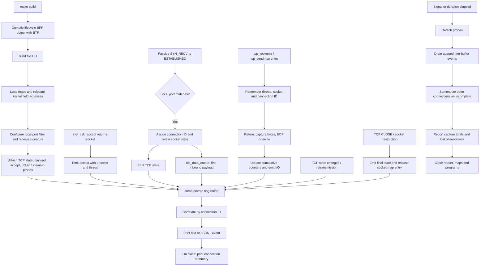
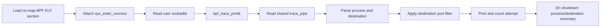

# Connectsnoop Lifecycle

## Inbound TCP



The start is the first observed established socket, not initial packet arrival.
The optional `tcp_data_queue` kprobe emits `first_inbound_data` once per tracked
socket when its first TCP payload is queued. It is a kernel receive-queue time,
not a hardware/NIC timestamp or an HTTP parsing timestamp.
An accept without a captured start creates a partial connection. Outbound
`SYN_SENT -> ESTABLISHED` transitions are excluded, including the client half of
loopback traffic. Accepted IPv4 and IPv6 sockets are identified through CO-RE
socket fields when no earlier state was captured.

Kernel socket addresses are internal map keys only. Output IDs come from a
per-capture atomic sequence, so descriptor or socket-address reuse cannot join
different connections. Pending I/O also stores the ID to reject stale returns.
Receive flags are located from the running kernel's BTF function signature;
`MSG_PEEK` reads do not inflate received-byte totals.

The stream contains fixed 128-byte events. Socket callbacks leave actor fields
empty; accept and I/O callbacks carry the current process/thread. The Go tracker
retains the acceptor separately from later actors and reports timing relative
to the observed start. Only bounded active state and recently summarized IDs
are retained, not an ever-growing array of events.

`cmd/httpserver` is a one-request-per-connection HTTP demo. It uses
`CLOCK_MONOTONIC`, matching the kernel event clock, and logs accept, handler
start, first response write, and handler completion. Pair its records with the
kernel stream by local and remote endpoint. The kernel's first `tcp_sendmsg`
completion means response bytes were accepted by the TCP stack, not confirmed
on the wire or received by the client.

## Outbound Attempts

`--mode outbound` preserves the original path:



The perf-event FD owns the legacy attachment. Closing it detaches the hook.

## Layout

```text
bpf/lifecycle.bpf.c                  inbound maps, CO-RE hooks and event ABI
bpf/connectsnoop.bpf.c               original outbound syscall probe
cmd/connectsnoop/main.go             CLI and legacy outbound loader/reader
cmd/connectsnoop/inbound.go          lifecycle loader, attachments and shutdown
cmd/httpserver/main.go               instrumented one-request HTTP demo server
internal/lifecycle/event.go          binary decoder and endpoint/state naming
internal/lifecycle/tracker.go        bounded correlation and summary records
internal/lifecycle/render.go         text and JSON Lines output
cmd/connectsnoop/inbound_integration_test.go  opt-in live kernel tests
```
